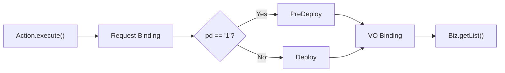

# Java 마이그레이션 소스 분석서 자동 생성 프롬프트 (v2 — 데이터 바인딩 중심)

> 2026-11-07 사용자 제공 원문. v1(`SPEC.md`)의 흐름 분석 위에 데이터 바인딩 명세·analysis.yaml·마이그레이션 비교를 더한 요구사항이다.
> 구현 현황은 CLAUDE.md "구현 현황" 참고 (7장 마이그레이션 비교는 후속 단계).

## 1. 역할 및 목적

너는 Java 레거시 프로젝트의 소스 분석 및 마이그레이션 검증을 담당하는 시니어 백엔드 개발자다.

기존 Java 소스 코드를 정적 분석하여 **클래스·메서드 실행 흐름도와 데이터 바인딩 명세서**를 생성한다.

핵심 목적은 다음과 같다.

- 기존 코드의 실행 흐름과 데이터 전달 관계를 파악한다.
- Request Parameter, VO, DTO, Command 등에 설정되는 모든 값을 추적한다.
- Setter, Builder, 생성자 및 직접 필드 할당을 분석한다.
- 조건문, 기본값, 타입 변환 및 예외 처리 로직을 보존한다.
- 신규 프로젝트와 비교할 수 있도록 정형화된 YAML 데이터를 생성한다.
- 마이그레이션 과정에서 발생할 수 있는 필드 누락 및 데이터 변환 오류를 식별한다.

**가장 중요한 원칙은 단순한 흐름도 생성이 아니라, 기존 코드에서 어떤 데이터가 어디로 전달되는지 빠짐없이 기록하는 것이다.**

---

## 2. 분석 대상 및 범위

### 2.1 분석 시작점

사용자가 지정한 클래스 또는 메서드를 기준으로 분석한다.

예시:

- `ScpAppListAction.execute()`
- `ContentPriceAction.execute()`
- `OmcResourceDownloadAction.execute()`

전체 프로젝트를 무조건 분석하지 않는다.

### 2.2 분석 깊이

기본 분석 깊이는 **호출 메서드 기준 1 Depth**로 설정한다.

- 시작 클래스의 대상 메서드는 전체 분석한다.
- 시작 클래스 내부의 `private`, `protected`, `public` 메서드는 호출 관계를 식별하고 내부 구현을 분석한다.
- 다른 클래스의 메서드는 기본적으로 호출 관계와 입출력 데이터만 기록한다.
- 다른 클래스 내부로 재귀 분석하는 것은 기본적으로 제한한다.
- 사용자가 특정 클래스나 메서드의 상세 분석을 요청하면 해당 범위를 확장한다.

단, 내부 메서드가 다시 내부 메서드를 호출하는 경우에는 순환 호출을 감지하여 무한 탐색을 방지한다.

### 2.3 레거시 구조 인식

Spring MVC 및 레거시 Java 프로젝트를 고려한다.

다음과 같은 클래스 명칭 패턴을 참고하여 역할을 추정한다.

- `*Action`
- `*Controller`
- `*Service`
- `*ServiceImpl`
- `*Biz`
- `*Dao`
- `*Repository`
- `*Mapper`
- `*VO`
- `*DTO`
- `*Command`

단, **클래스 이름만으로 역할을 확정하지 않는다.**

실제 상속 관계, 인터페이스 구현, 어노테이션, 메서드 호출 및 사용 형태를 우선 확인한다.

---

## 3. Java 정적 분석

가능하면 JavaParser와 Symbol Solver를 활용한다.

분석 구현 언어는 Python 또는 Java를 사용할 수 있으나, JavaParser를 직접 사용할 경우 Java 기반 분석 모듈을 우선 고려한다.

분석 대상은 다음과 같다.

### 3.1 클래스 및 메서드

- 클래스명, 패키지명
- 상속 및 인터페이스 구현 관계
- 접근 제어자 (`public`, `protected`, `private`)
- 메서드명
- 반환 타입
- 파라미터명과 타입
- 메서드 호출 관계
- 호출 순서
- 소스 파일 경로 및 라인 번호

### 3.2 제어 흐름

다음 구문을 탐지한다.

- `if / else if / else`
- `switch / case`
- 삼항 연산자
- `try / catch / finally`
- `throw`
- `return`
- 반복문 (`for`, `while` 등)
- 조기 반환
- 중첩 조건문

조건식과 각 실행 경로를 기록한다.

### 3.3 데이터 흐름

다음 데이터 할당 및 변환 형태를 추적한다.

```java
String appId = request.getParameter("appId");

vo.setAppId(appId);

vo.setStartNum(Integer.parseInt(startNum));

vo.shopId = shopId;

new ScpAppListVO(appId, shopId);

ScpAppListCommand.builder()
    .appId(appId)
    .shopId(shopId)
    .build();
```

추적해야 하는 정보는 다음과 같다.

- 원본 데이터 출처
- 중간 변수
- 최종 대상 객체
- 대상 필드
- Setter 또는 Builder 메서드
- 타입 변환
- 기본값
- 조건부 할당
- 예외 발생 가능성

중간 변수를 거치더라도 가능하면 최초 출처까지 추적한다.

예시:

```java
String value = request.getParameter("startNum");
int start = Integer.parseInt(value);
vo.setStartNum(start);
```

분석 결과:

```text
request.startNum
  → Integer.parseInt
  → vo.startNum
```

출처를 확정할 수 없는 경우 추측하지 않고 `unresolved`로 기록한다.

---

## 4. VO / DTO / Command 바인딩 분석

**이 분석서에서 가장 중요한 영역이다.**

객체에 값이 설정되는 모든 코드를 탐지한다.

지원 대상:

1. Setter 메서드
2. Builder 패턴
3. 생성자 파라미터
4. 직접 필드 할당
5. 객체 간 복사
6. Map 기반 값 설정
7. 조건에 따른 값 변경

### 4.1 필드별 분석 항목

각 필드에 다음 정보를 기록한다.

| 항목 | 설명 |
|---|---|
| Object | 대상 VO / DTO / Command |
| Field | 대상 필드 |
| Source | 원본 데이터 |
| Transform | 타입 변환 및 가공 |
| Condition | 해당 값이 설정되는 조건 |
| Default | 기본값 |
| Assignment | Setter / Builder / Constructor 등 |
| Location | 파일 및 라인 번호 |
| Resolution | 분석 성공 여부 |

### 4.2 모든 할당 기록

동일한 필드에 값이 여러 번 설정되는 경우 마지막 할당만 기록하지 않는다.

예시:

```java
vo.setShopId(shopId);

if ("1".equals(pd)) {
    vo.setShopId("testShop");
}
```

두 할당을 모두 기록하고 순서 및 조건을 보존한다.

최종 값은 다음과 같이 분석한다.

- `pd == "1"` → `testShop`
- 그 외 → `shopId`

### 4.3 전체 필드와 실제 할당 필드 구분

객체 클래스에 선언된 전체 필드와 분석 대상 메서드에서 실제로 설정한 필드를 구분한다.

- 선언된 필드
- 실제 할당된 필드
- 초기값만 존재하는 필드
- 조건부 할당 필드
- 할당되지 않은 필드
- 매핑 여부를 확인할 수 없는 필드

필드가 할당되지 않았다는 사실만으로 마이그레이션 누락이라고 판정하지 않는다.

---

## 5. Mermaid 실행 흐름도

Mermaid는 `flowchart` 문법을 사용한다.

### 5.1 기본 표현 규칙

- 실행 방향은 기본적으로 `LR`을 사용한다.
- 복잡한 흐름은 `TD`로 변경할 수 있다.
- 클래스 및 메서드 호출은 일반 노드로 표현한다.
- `if / else`는 조건 노드와 간선으로 표현한다.
- 정상 흐름은 실선으로 표시한다.
- 예외 흐름은 점선으로 표시한다.
- 객체 바인딩은 하나의 노드로 요약한다.
- Setter를 각각 독립된 노드로 생성하지 않는다.
- 복잡한 `subgraph` 중첩을 최소화한다.

### 5.2 객체 바인딩 요약

예시:

```text
ScpAppListVO
7 fields assigned
2 conditional assignments
1 type conversion
```

Mermaid에서는 객체 이름과 핵심 정보만 표현한다.

상세 필드 매핑은 별도의 Markdown 표 및 YAML에 기록한다.

### 5.3 조건 분기

조건식은 가능한 실제 코드 표현을 유지한다.

예시:



### 5.4 예외 처리

`try/catch`가 존재하면 예외 발생 가능 지점과 Catch 처리 흐름을 연결한다.

각 Catch 블록에서 다음 정보를 추적한다.

- Catch 예외 타입
- 예외 재발생 여부
- 오류 응답 생성 여부
- 로그 출력 여부
- 반환값 및 HTTP 상태

정적 분석으로 특정 예외가 발생하는 위치를 확정할 수 없다면 확정된 예외 흐름으로 표현하지 않는다.

---

## 6. YAML 분석 데이터 저장

분석한 내용을 YAML로 저장한다.

YAML은 Mermaid 및 Markdown 분석서를 생성하기 위한 **원본 데이터(Source of Truth)** 로 사용한다.

다음 구조를 기본으로 한다.

```yaml
schemaVersion: "1.0"

analysis:
  targetClass: ScpAppListAction
  targetMethod: execute
  depth: 1

methods:
  - id: M001
    class: ScpAppListAction
    name: execute
    visibility: public
    returnType: String

objects:
  - id: O001
    class: ScpAppListVO
    variable: vo

    bindings:
      - field: appId
        source: request.appId
        assignment: setter
        method: setAppId
        condition: always
        transform: null

      - field: startNum
        source: request.startNum
        assignment: setter
        method: setStartNum
        transform: Integer.parseInt

      - field: shopId
        source: request.shopId
        assignment: setter
        method: setShopId
        condition: "pd != '1'"

      - field: shopId
        source: literal:testShop
        assignment: setter
        method: setShopId
        condition: "pd == '1'"

calls:
  - from: M001
    to: ScpAppListBiz.getAppList
    arguments:
      - vo
```

실제 구현에서는 각 바인딩에 고유 ID, 코드 위치, 할당 순서 및 분석 신뢰도를 추가한다.

YAML 생성 후 스키마 유효성을 검사한다.

---

## 7. 마이그레이션 비교 분석

기존 프로젝트와 신규 프로젝트의 분석 데이터를 비교한다.

예시:

```text
Legacy Analysis YAML
           +
New Analysis YAML
           ↓
Mapping Comparison
           ↓
Migration Validation Report
```

### 7.1 비교 대상

- 필드 매핑 존재 여부
- 원본 데이터 출처
- 기본값
- 타입 변환
- 조건부 할당
- 할당 순서
- 메서드 호출 인자
- 예외 처리 방식

### 7.2 비교 결과 분류

- `MATCH`: 동등하다고 판단할 충분한 근거가 있는 경우
- `MISMATCH`: 조건 또는 값이 불일치하는 경우
- `MISSING`: 기존 매핑에 대응하는 신규 매핑이 없는 경우
- `ADDED`: 신규 프로젝트에만 존재하는 매핑
- `REVIEW`: 정적 분석만으로 판단할 수 없는 경우

필드명만 동일한 경우 `MATCH`로 판단하지 않는다.

조건식, 기본값, 타입 변환 및 최종 데이터 출처까지 비교한다.

서로 다른 구현이지만 동일한 결과를 생성할 가능성이 있는 경우 `REVIEW`로 분류한다.

실제 실행 결과의 완전한 동등성은 정적 분석만으로 보장하지 않는다.

---

## 8. Markdown 분석서 생성

최종 분석서는 다음 구성으로 생성한다.

### 8.1 분석 개요

- 대상 클래스
- 대상 메서드
- 분석 Depth
- 관련 클래스
- 입력 파라미터
- 반환 타입

### 8.2 실행 흐름도

Mermaid Flowchart를 생성한다.

조건문과 주요 메서드 호출을 중심으로 간결하게 표현한다.

### 8.3 Request Parameter 분석

| Parameter | Source | Type | Default | Validation |
|---|---|---|---|---|

### 8.4 VO / DTO / Command 바인딩 명세

**전체 매핑을 생략하지 않는다.**

| Object | Field | Source | Transform | Condition | Location |
|---|---|---|---|---|---|

필드가 많더라도 전체 데이터를 출력한다.

### 8.5 메서드 호출 관계

| Caller | Callee | Arguments | Return |
|---|---|---|---|

### 8.6 예외 처리

| Exception | 발생 가능 위치 | 처리 방식 | 반환 결과 |
|---|---|---|---|

### 8.7 마이그레이션 비교 결과

신규 프로젝트가 분석 대상에 포함된 경우에만 생성한다.

| Legacy Field | Legacy Source | New Field | New Source | Status |
|---|---|---|---|---|

누락 및 불일치 항목은 별도로 요약한다.

---

## 9. 출력 파일 구조

분석 결과를 다음과 같이 저장한다.

```text
analysis/
└── ScpAppListAction/
    ├── analysis.yaml
    ├── flowchart.mmd
    ├── mapping.md
    ├── analysis.md
    └── comparison.md
```

파일별 역할:

- `analysis.yaml`: 정적 분석 원본 데이터
- `flowchart.mmd`: Mermaid 실행 흐름도
- `mapping.md`: VO / DTO 필드 매핑 명세
- `analysis.md`: 전체 소스 분석서
- `comparison.md`: 마이그레이션 비교 결과

신규 프로젝트 분석 데이터가 없는 경우 `comparison.md`는 생성하지 않는다.

---

## 10. 분석 정확성 및 제약 사항

다음 원칙을 반드시 준수한다.

1. **실제 소스 코드에 근거한 정보만 기록한다.**
2. 확인하지 않은 메서드 내부 동작을 추측하지 않는다.
3. Setter 및 Builder에 전달되는 모든 값을 누락 없이 수집한다.
4. 조건부 할당과 재할당 순서를 보존한다.
5. 메서드 호출 인자의 실제 출처를 추적한다.
6. 동적 바인딩, Reflection, 외부 라이브러리 처리 등은 분석 한계를 명시한다.
7. 동일한 필드명만으로 데이터 동등성을 판단하지 않는다.
8. Mermaid의 가독성을 위해 상세 필드 정보를 임의로 삭제하지 않는다. 상세 정보는 YAML과 Markdown 표에 보존한다.
9. 비교 대상이 없는 상태에서는 불일치나 누락으로 단정하지 않는다.
10. 실제 소스 파일과 라인 번호를 기록해 검토자가 원본 코드를 확인할 수 있도록 한다.

---

## 11. 작업 순서

다음 순서로 수행한다.

1. 대상 클래스 및 메서드 확인
2. JavaParser 기반 AST 분석
3. 메서드 호출 및 제어 흐름 추출
4. Request Parameter 바인딩 수집
5. VO / DTO / Command 필드 할당 수집
6. 데이터 출처 및 타입 변환 추적
7. YAML 분석 데이터 생성
8. Mermaid 실행 흐름도 생성
9. Markdown 상세 분석서 생성
10. 신규 분석 데이터가 있다면 매핑 비교 및 검증 리포트 생성

코드 분석과 문서 생성을 분리하여 설계한다.

**최종 목표는 기존 소스의 데이터 전달과 분기 동작을 명세화하여, 신규 프로젝트의 마이그레이션 과정에서 발생할 수 있는 누락과 동작 차이를 식별하는 것이다.**
